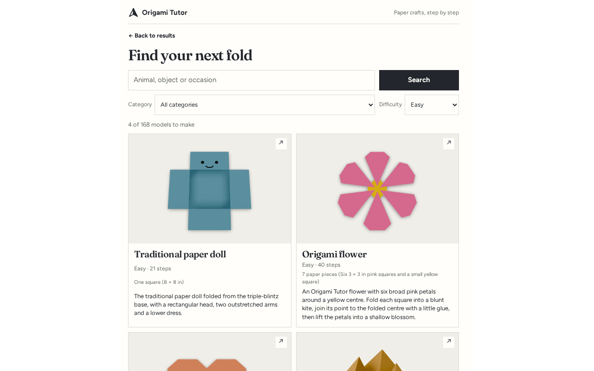
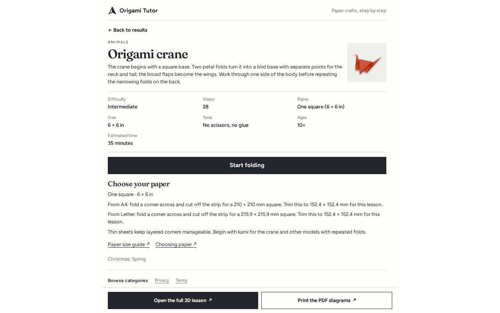
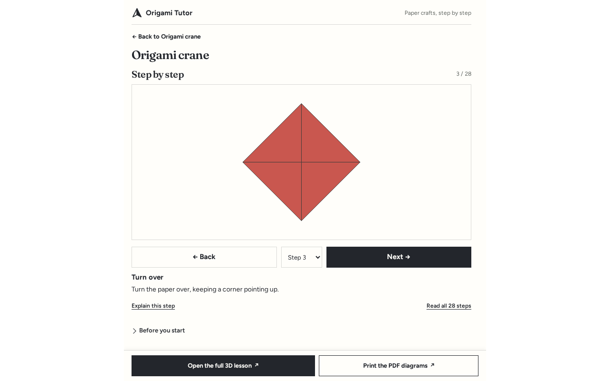

# Origami Tutor MCP server


Origami Tutor is a hosted, read-only [Model Context Protocol](https://modelcontextprotocol.io) server for paper folding. An AI assistant can use it to find an origami or paper-craft model, explain the paper it needs, and walk you through every illustrated step. In hosts that support MCP Apps (ChatGPT, Claude), it also shows an interactive catalog and step viewer.

- Website: https://origamitutor.com
- MCP endpoint: `https://origamitutor.com/api/mcp` (Streamable HTTP, no sign-in)
- Official MCP Registry name: `com.origamitutor/origami-tutor`

This repository holds the public server description, icons and connection instructions. The server itself is hosted at origamitutor.com, so there is nothing to install or run locally.

## Tools

All tools are read-only.

| Tool | What it does |
|---|---|
| `find_origami` | Finds a model by name, animal, object, occasion or difficulty. It understands everyday names such as "paper plane" and "cootie catcher". |
| `get_origami` | Summarizes one model: paper and size, difficulty, scissors or glue, occasions and age guidance. |
| `get_origami_steps` | Returns every folding instruction with its 2D diagram, so the assistant can guide you step by step. |
| `suggest_origami` | Suggests models for an occasion, a child's age, a difficulty or a time budget. |
| `list_categories` | Lists the craft categories and origami subjects with current model counts. |

## Connect

### ChatGPT and Claude

Add a custom connector with the URL `https://origamitutor.com/api/mcp`.

### Claude Desktop, Cursor, Cline and other MCP clients

```json
{
  "mcpServers": {
    "origami-tutor": {
      "url": "https://origamitutor.com/api/mcp"
    }
  }
}
```

Clients that only launch local servers can connect through a bridge such as [`mcp-remote`](https://www.npmjs.com/package/mcp-remote):

```json
{
  "mcpServers": {
    "origami-tutor": {
      "command": "npx",
      "args": ["-y", "mcp-remote", "https://origamitutor.com/api/mcp"]
    }
  }
}
```

## Try asking

- "Show me easy origami for kids."
- "How do I make a paper plane?"
- "What can I fold for Mother's Day in 20 minutes?"
- "What paper do I need for a crane?"

## Screenshots

| Catalog | Model | Steps |
|---|---|---|
|  |  |  |

## Privacy and support

- Privacy: https://origamitutor.com/privacy
- Terms: https://origamitutor.com/terms
- Support: support@origamitutor.com

The server stores no personal data. When you follow a link from the app to the website, the site records the link source, the page, the time, the country and a bot flag. It records no IP address and sets no cookies.

## License

The text and icons in this repository are released under the [MIT License](LICENSE).
